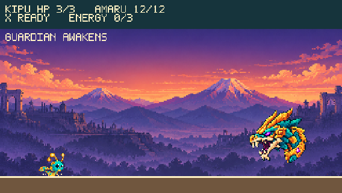

# PachaByte

A 320×180 pixel-art arcade where Kipu, a turquoise-and-gold guardian, trains in Arequipa and faces **Amaru**, an Andean serpent guardian. Built with Phaser 3, TypeScript and Vite.

**[Play in your browser](https://andrewmechdev.github.io/pachabyte/)** · keyboard only · desktop



## Quick path

1. Open the link above and click the game.
2. Press **Enter** to fight Amaru, or **1** for the optional four-target training route.
3. Press **X** in the fight to slow, capture and return Amaru's bolts.

## Controls

| Action | Keys |
| --- | --- |
| Move | A/D or ←/→ |
| Jump | W, Space or ↑ |
| Fire | Hold J or Z |
| PachaShift (Amaru fight) | X |
| Retry / map | R / M (Enter after a result) |
| Choose challenge | 1 Explore Arequipa · 2 or Enter Play Amaru |
| Sound | "Sound: on/off" button under the title |

## What is in the demo

| Feature | Detail |
| --- | --- |
| Amaru fight | One phase, two telegraphed attacks (aimed pulse, marked rune column), HP, victory, defeat and retry |
| PachaShift | Slows nearby bolts, captures up to three, returns them as real damage; the screen switches to a four-green palette while active |
| Training route | Four targets across a scrolling Arequipa route; optional, never a gate |
| Animation | Kipu idle, run, jump and land frames derived from the approved art; Amaru rear-back, lunge and hit flash; pooled pixel particles |
| Sound | 16 effects synthesized in the browser with Web Audio; no audio files |
| Session achievements | Earned by playing; reset on refresh |

## Run it locally

Requirements: Node.js 22.12+ and npm.

```bash
npm ci
npm run dev        # http://127.0.0.1:5173/
```

| Command | Purpose |
| --- | --- |
| `npm run typecheck` | TypeScript check |
| `npm test` | Unit tests (Vitest) |
| `npm run build` | Production build into `dist/` |
| `npm run preview` | Serve the build on 4173 |
| `npm run test:browser` | Real-keyboard browser smoke test against a running preview (needs Playwright and Edge; set `PACHA_URL`, `PACHA_RENDERER=canvas` to switch renderer) |

## Project map

- `src/game/` scenes, pure gameplay rules, animation, sound and procedural visuals.
- `tests/` deterministic rules tests and the browser smoke runner.
- `assets/` preserved sources, prepared runtime art and references.
- `docs/` design, art bible, validation and verification evidence.
- `odd/tasks/` feature tracking.

## Honest limits

- Art is static original demo art: Kipu frames are derived edits of one image, and Amaru is a head with rotation and effects, not a fully articulated boss.
- Desktop keyboard only. No touch controls, no persistent saves, no music.
- Automated checks prove behavior, not game feel or sound taste; human playtesting is still pending. See [docs/VERIFICATION.md](docs/VERIFICATION.md).

## Credits and license

Code is MIT ([LICENSE](LICENSE)). Art, audio and font provenance is in [CREDITS.md](CREDITS.md).
