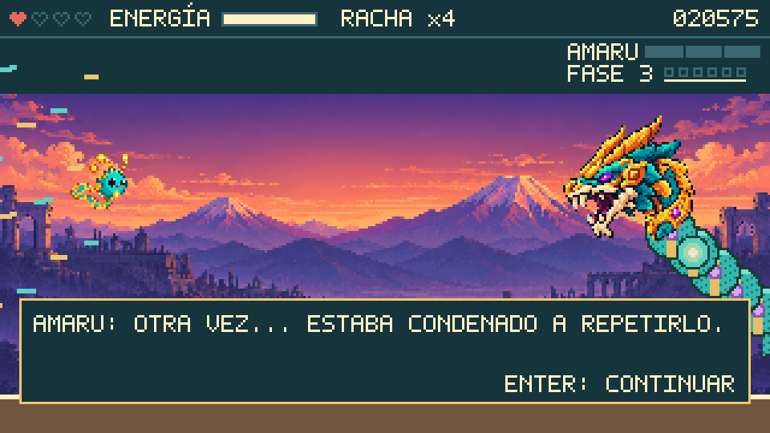

# PachaByte

When El Desfase corrupts the Trama de Pacha, an ancestral-digital network of a fantasy Peru, Kipu flies through routes overrun by bugs, learns to turn attacks around with **PachaShift**, and frees guardians to bring the lost connections back. This build is **Ruta 01**: a free-flight route through Arequipa that ends in the fight against **Amaru-01**, a serpent guardian stuck in a loop. Built with Phaser 3, TypeScript and Vite at 320×180.

**[Play in your browser](https://andrewmechdev.github.io/pachabyte/)** · keyboard only · desktop

> This is an early, keyboard-only prototype for desktop browsers; new versions deploy to the same link automatically. Art was generated with an image AI (see [CREDITS.md](CREDITS.md)).



## Quick path

1. Click the game, then press **Enter** on the map to fly Ruta 01 (about 70 s), or **2** to go straight to Amaru.
2. On the route: fly with **WASD** or arrows, hold **Space** or **J** to fire, collect gold fragments to fill **ENERGÍA**.
3. Against Amaru: when the meter is full, press **Shift** or **K**. The world turns four-tone green and slows down; fly into the rhombus bolts to capture them, and they fly back to crack Amaru's shield.

## Controls

| Action | Keys |
| --- | --- |
| Fly (8 directions, no gravity) | WASD or arrow keys |
| Fire | Space or J (Z also works) |
| PachaShift REVERSE (Amaru, meter full) | Shift or K (X also works) |
| Pause / resume | Esc (P also works) |
| Retry | R |
| Back to the map | M |
| Start the route / continue dialogue / leave the result | Enter |
| Page buttons | Jugar ruta · Ir a Amaru · Mapa · Reintentar · Sonido · Reducir movimiento |

Moving keyboard focus away from the game (Tab to the page buttons, or switching windows) pauses it; click the game to continue.

## What is in Ruta 01

| Part | What happens |
| --- | --- |
| Map | Arequipa node "Santuario de la Trama", corrupted until Amaru is freed; other routes locked and unnamed |
| Route | Auto-scrolling flight: arrival, first Glitchlings (2 hits each), fragment lines (+100 score, +20 meter), three Firewall columns with a telegraphed gap that blocks shots, the Marea del Desfase pushing from the left, and a silent threshold |
| Carried state | Hearts, score, fragments and meter carry into the fight |
| Amaru-01 | 100 HP in three phases by health: triple aimed pulse; loops of capturable rhombi behind a 6-point shield; bursts, a non-capturable wave with a gap, and a double-damage window |
| PachaShift REVERSE | Charges from hits (+10) and fragments (+20); 0.8 s of real time with the world at 20 %, capture radius 28 px, up to 6 captures, captured bolts orbit Kipu harmlessly and return for 3 damage each |
| Liberation | The corruption recedes, a color wave restores the arena, two dialogue lines, a Codex entry and a score breakdown; the map node is restored |
| Accessibility | Spanish text, reduce-motion toggle (follows the OS setting), sound toggle, focus pause |
| Sound | Synthesized in the browser with Web Audio; no audio files |

## Run it locally

Requirements: Node.js 22.12+ and npm.

```bash
npm ci
npm run dev        # http://127.0.0.1:5173/
```

| Command | Purpose |
| --- | --- |
| `npm run typecheck` | TypeScript check |
| `npm test` | Unit tests for the pure rules (Vitest) |
| `npm run build` | Production build into `dist/` |
| `npm run preview` | Serve the build on 4173 |
| `npm run test:browser` | Keyboard-driven browser smoke against a running preview (Playwright + Edge, Python with Pillow for the palette check). Set `PACHA_URL` for another port and `PACHA_RENDERER=canvas` for the Canvas renderer |

## Project map

- `src/game/` scenes (`MapScene`, `RouteScene`, `GuardianScene`), pure rules (`routeRules`, `reverseRules`, `amaruRules`, `liberationRules`), HUD, sound and procedural placeholder art.
- `tests/` unit tests for every rule module and the browser smoke runner with its own scripted keyboard pilot.
- `docs/design/` the design canon (Spanish); `docs/VERIFICATION.md` observed evidence.
- `odd/tasks/` feature tracking.

## Honest limits

- **Placeholder art.** Glitchlings, fragments, Firewall, Marea and Amaru's body segments are procedural placeholders; the restored Amaru head reuses the original art. Requests for final art are in [docs/design/ASSET_REQUESTS.md](docs/design/ASSET_REQUESTS.md).
- **Untested balance.** Every number (speeds, HP, timings, score) is a tentative value from the design canon. No human playtest has tuned it yet; automation proves behavior, not feel.
- **Keyboard and desktop only.** No touch controls, no gamepad, no saves (progress resets on refresh), no music.
- Accented capitals in the 5×7 pixel font read a little like small caps.

See [docs/VERIFICATION.md](docs/VERIFICATION.md) for what was actually checked.

## En español

**PachaByte** es un arcade de vuelo libre: El Desfase corrompe la Trama de Pacha y Kipu recorre la Ruta 01 en Arequipa, esquiva Glitchlings, recoge fragmentos, cruza firewalls y escapa de la Marea del Desfase hasta llegar a Amaru-01. Con la energía llena, **PachaShift** ralentiza el mundo en verde monocromo: atrapa los rombos y se devuelven solos para romper el escudo del guardián y liberarlo.

| Acción | Teclas |
| --- | --- |
| Volar | WASD o flechas |
| Disparar | Espacio o J |
| PachaShift | Shift o K (con la energía llena) |
| Pausa | Esc |
| Reintentar | R |
| Mapa | M |
| Iniciar ruta / continuar | Enter |

El arte es provisional y el balance aún no se ha probado con jugadores.

## Credits and license

Code is MIT ([LICENSE](LICENSE)). Art, audio and font provenance is in [CREDITS.md](CREDITS.md).
